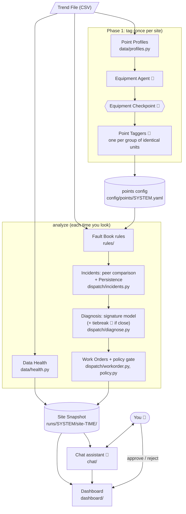
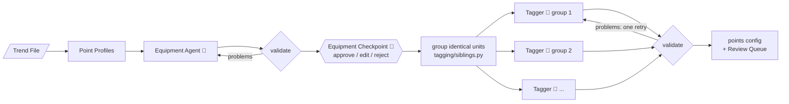
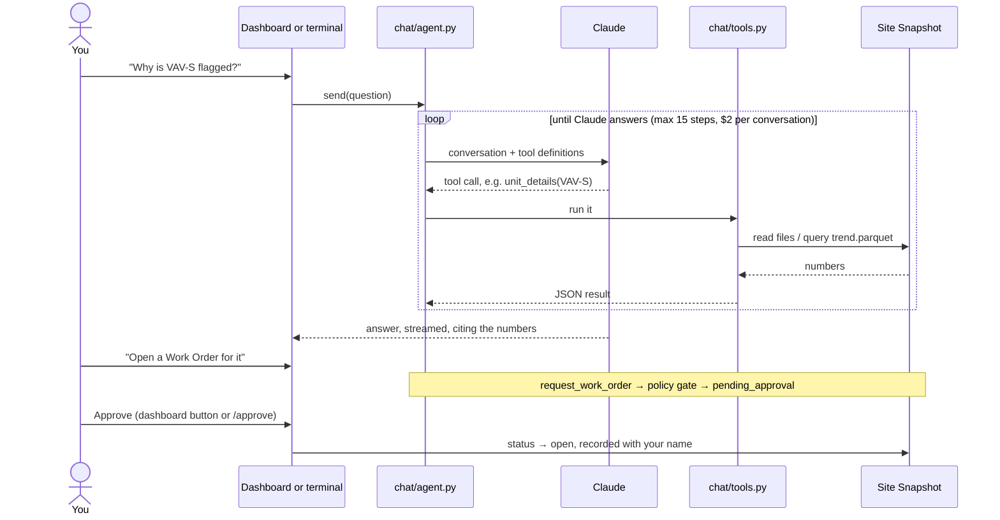

# 2. Architecture

How the pieces fit together. Terms in **bold** are defined in the [glossary](glossary.md); the reasons behind each choice are in [decisions/](decisions/).

## The big picture



🤖 = a model call. 👤 = a person decides. Everything else is deterministic code.

There are two stages with different rhythms:

- **Tagging runs once per site.** It turns raw point names into a reviewed **points config**: each point's unit and Haystack tags. That config is what every later step runs on.
- **`analyze` runs each time you want to know the site's current state.** It runs every deterministic step once and saves the results as a **Site Snapshot**: plain files in one folder. The chat and the dashboard only read that snapshot, so they always agree, and every number traces back to a file.

## Phase 1: tagging



1. **Profiles, not raw data.** The agents never see telemetry. Each point is summarized in one line: its range, typical values, how often it changes, whether it's continuous or stepped, and which other points move with it. That's what an engineer looks at when tagging from a trend, and it keeps the prompt small.
2. **Equipment Agent** groups points into units (an AHU, four VAV boxes), assigns equipment types, and links each box to the AHU that feeds it.
3. **Equipment Checkpoint.** The run pauses (a LangGraph interrupt) until a person approves, edits, or rejects the equipment. Nothing is tagged on a wrong equipment list.
4. **Identical units are tagged once.** Units whose point names differ only by a unit token (`VAV_DMPR_S` vs `VAV_DMPR_E`) and whose data behaves alike form a group. One **Point Tagger** per group runs in parallel, and its decisions are copied to the rest. That keeps them consistent and cuts the cost by about a third.
5. **Validation.** Code checks every answer (legal Haystack tags, every point accounted for). A failed answer gets one retry with the problems listed. Anything still wrong, or tagged with low confidence, goes to the **Review Queue** rather than silently into the config.

`--mode single` runs one agent that does all of this in a single call. It's the baseline the multi-agent version is measured against.

## `analyze`: from data to Work Orders

`site/analyze.py` runs these steps in order, as of the last day in the file (or `--as-of`):

| Step | What it does | Code | Settings |
|---|---|---|---|
| Load | Reads the Trend File into DuckDB and saves a Parquet copy in the snapshot | `data/trend.py` | |
| **Data Health** | Per point: coverage, longest gap, frozen temperature/humidity readings, implausible values. For the file: stretches where no rows arrived at all (a controller or network outage) | `data/health.py` | `config/health.yaml` |
| **Fault Book** | Runs the enabled open-fdd rules on each unit. Each rule finds its points by Haystack tags, never by raw names. Output: **Candidate Windows** | `rules/` | `config/faultbook.yaml`, `config/haystack_roles.yaml` |
| Peer comparison | Turns windows into fault minutes per unit, rule, and day, then counts only the minutes above the unit's worst identical sibling. Noise that hits every box equally cancels out | `dispatch/incidents.py` | `config/dispatch.yaml` |
| **Persistence** | Classifies each finding over the 14-day lookback: continuous, daily, weekly, sporadic, or stale. Only the first three can be dispatched | `dispatch/incidents.py` | `config/dispatch.yaml` |
| Diagnosis | A learned **Fault Signature** model ranks likely faults (including "none", meaning noise) from which rules persist. If the top two are within 20 points and `--tiebreak` is on, a model reads an evidence table (this unit vs. its siblings) and picks | `dispatch/diagnose.py` | `models/signature_model.yaml` |
| **Work Orders** | One per unit at most. Priority, trade, and action are looked up and computed by code, then the policy gate approves, holds, or blocks it | `dispatch/workorder.py`, `dispatch/policy.py` | `config/remediation.yaml`, `config/policy.yaml` |

Units that misbehave but don't qualify end up on the **Watch List** with the reason (sporadic, or "looks like noise").

### What a Site Snapshot holds

```
runs/<system>/site-<time>/
  snapshot.json            period, every unit's status, findings, diagnosis, data health; counts
  work_orders.json         Work Orders and their status: the Review Queue for Work Orders
  health_points.csv        Data Health per point
  candidate_windows.csv    every flagged window
  rule_outcomes.csv        each rule's result per unit (fault hours, or skipped and why)
  daily_rule_minutes.csv   fault minutes per unit, rule, and day; raw and above siblings
  points.yaml              the points config used
  trend.parquet            the data, for fast loading by the chat and the dashboard
```

## The chat assistant



One agent, nine tools. Eight only read: site overview, unit details, Work Orders, data health, rule activity, a rule's definition, point search, and trend data. The ninth requests a Work Order. The assistant doesn't recompute anything: the analysis already happened in `analyze`, so its job is to find the right numbers and explain them. That includes comparing a unit with its siblings and arguing the closest look-alike fault ([ADR-0008](decisions/0008-site-snapshot-chat-and-dashboard.md)).

## Where people decide

| Checkpoint | When | How |
|---|---|---|
| Equipment Checkpoint | During `tag`, before any point is tagged | Terminal prompt: approve, edit the file, or reject |
| Review Queue (tags) | After `tag` | `review_queue.yaml` lists low-confidence or invalid tags to check |
| Points config | Before `analyze` | Reviewed file in `config/points/` |
| Review Queue (Work Orders) | Any time | Dashboard Work Orders page, or `/approve WO-n` in the terminal chat |

## How safety is enforced

Safety is enforced by code, not by asking the model nicely:

- **The policy gate** (`dispatch/policy.py`, rules in `config/policy.yaml`) decides every action. The first matching rule wins:
  - Anything touching life-safety equipment (fire, smoke, freezestat) is blocked.
  - Pipeline Work Orders are approved, because they only report.
  - Work Orders requested in chat need a person.
  - Setpoint changes need a person if within bounds and are blocked otherwise.
  - Anything unknown is blocked.
- **Priority is computed** from the fault's consequence (safety > equipment > energy > comfort), its Persistence, and its magnitude. A model never sets it.
- **Only a person can approve.** `Site.decide` is called by the dashboard button or the terminal command, never by a tool.
- **Ground truth is kept apart.** Fault labels live in `benchmark/ground_truth/`. Only the scorers read them; no agent can.
- **Local by default.** The dashboard listens only on this computer, the API key stays in `.env` or the browser session, and every chat conversation has a cost cap.

## The benchmark, alongside

`benchmark/` runs the same library code over all the LBNL cases and scores it against the labels. It's kept out of `src/` so the tool has no LBNL-specific code ([ADR-0004](decisions/0004-generic-trend-file-import.md)). The flow:

```
setup/fetch.py → data/lbnl/ → tag (phase 1) / phase2_run_rules.py → phase2_score_rules.py
                                            └→ phase4_dispatch.py, phase4_tiebreak.py → docs/results/
                                            └→ train_signature_model.py → models/signature_model.yaml (used by analyze)
```

The signature model `analyze` ships with is trained here, on every PFPU and SFPU case. Its accuracy on unseen cases is estimated by leaving each case out in turn ([results/phase4-dispatch-dev.md](results/phase4-dispatch-dev.md)).
